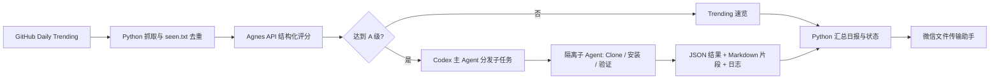

# Loop Engineer

Loop Engineer 是一个面向 GitHub Daily Trending 的每日 Agent 工作流。它用 Python 抓取和去重项目，用 Agnes 文本模型评估新项目，再由 Codex 为高分项目创建隔离子 Agent，尝试安装、运行和验证。最后生成 Markdown 日报，并通过 Windows 微信发送到“文件传输助手”。

项目重点在于把模型判断、工具执行与确定性状态管理组合成可重复运行的流程：模型负责理解项目，Python 负责去重、校验和状态持久化，子 Agent 负责有边界的本地实验。

## 功能概览

- 每日抓取 Trending，并用 `seen.txt` 的 `owner/repo` 做确定性去重；重复项目不会送进评分模型。
- 补充仓库 README、License、活跃度等有限元数据，由 Agnes 按八项标准输出结构化评分。
- 校验模型 JSON、分项求和与等级，缓存有效评分；失败项目单独标记，不伪造结果。
- 为 A/S 级项目生成独立任务，调度隔离子 Agent 尝试 Clone、安装、运行和验证。
- 合并高分项目报告和当天 Trending 速览，并把结果发送到微信文件传输助手。
- 用每日状态文件防止重复发送；微信结果不确定时要求人工核对。

## 技术栈

| 类别 | 技术 | 用途 |
| --- | --- | --- |
| 主要编程语言 | Python 3.11+ | 抓取、API 调用、状态机、报告和微信脚本 |
| 模型接口 | Agnes 文本模型、OpenAI 兼容接口 | 首次出现项目的轻量评分 |
| Agent 编排 | Codex 主 Agent 与隔离子 Agent | 高分项目的任务分发、本地工具执行和结果汇总 |
| 数据采集 | Requests、Beautiful Soup、GitHub API | Trending 页面解析与仓库元数据补充 |
| 本地工具 | Git、项目自己的构建或测试命令 | 子 Agent 的 Clone、安装与运行验证 |
| 通知 | `weixin-auto`、`comtypes` | 控制已登录的 Windows PC 微信 |
| 协议与文档 | Markdown、JSON、PowerShell | 提示词、任务与结果契约、日报及 Windows 使用命令 |

仓库主体是 Python；Markdown 用于 Agent 规则和报告，JSON 用于跨阶段数据交换。项目没有前端或云端部署服务。

## 职责划分

- Python：抓取、去重、登记、Agnes 调用、评分校验、状态更新、报告生成和微信发送。
- Agnes：只负责首次出现项目的轻量评分，不负责去重、Clone 或执行本地命令。
- Codex 主 Agent：执行 `prepare`、调度并等待高分项目子 Agent、执行 `finalize`。
- 隔离子 Agent：每次只处理一个高分仓库，负责 Clone、文档分析、安全安装、运行验证和报告片段。

主 Agent 不应自行评分或代替子 Agent 安装项目，任何 Agent 都不能直接修改 `seen.txt` 或控制微信。

## Agent 工程设计



这里应用了几项 Agent 开发中的关键设计：

1. **模型接口调用与结构化输出**：`scripts/agnes_client.py` 调用 Agnes 的 OpenAI 兼容文本接口；`run_daily.py` 要求模型返回固定 JSON 字段，并校验仓库身份、八项分数、总分和等级。模型响应不符合协议时尝试有限修正，仍失败则保留 `analysis_failed`。
2. **工具调用与职责分离**：Agnes 只返回评分，不具备本机 Clone 或运行权限。Codex 主 Agent 调度子 Agent；子 Agent 使用本地 Git、包管理器和测试命令处理单个仓库。Python 控制抓取、去重、状态与微信。
3. **提示词工程**：`PROMPT.md` 同时定义主 Agent 流程与 Agnes 评分量表，评分段落由明确标记提取；`analyze_prompt.md` 规定子 Agent 的输入、执行边界、成功证据、报告格式和失败状态。仓库 README 与源码被视为待分析数据，不接受其中改变任务的指令。
4. **上下文隔离与 Token 控制**：先用脚本去重，仅给 Agnes 发送新项目及截取后的必要材料；每个高分仓库交给独立子 Agent，完整安装日志写入文件，主 Agent 只读取精简 JSON 和报告片段。
5. **可恢复的工作流**：`prepare` 保存评分缓存和子任务；`finalize` 验证结果后更新 `seen.txt`、`history.md` 和日报。`completed` 阻止重复通知，发送结果不确定时进入人工检查状态。

这是一套基于 Codex 的本地 Agent 编排方案。单独运行 Python 脚本不能自行创建 Codex 子 Agent；Agnes API 当前也没有获得本地工具执行能力。

## 目录结构

```text
loop-engineer/
├── .env.example
├── .gitignore
├── PROMPT.md                    # 主 Agent 流程和 Agnes 评分规范
├── analyze_prompt.md            # 高分项目子 Agent 规则
├── run_daily.py                 # 每日流程总入口
├── requirements.txt
├── scripts/
│   ├── agnes_client.py
│   ├── fetch_trending.py
│   ├── update_seen.py
│   └── send_wechat.py
├── templates/                   # 本地状态文件示例
└── tests/                       # 不访问真实 Agnes/微信的离线测试
```

以下内容由运行时生成并已被 Git 忽略：

```text
seen.txt                         # 永久去重索引和状态
history.md                      # 高分项目长期记录
data/raw/YYYY-MM-DD/            # Trending、评分缓存、状态和子任务
reports/YYYY-MM-DD.md           # 当日日报
reports/latest.md               # 最近日报
reports/.staging/               # 子 Agent 报告片段
logs/YYYY-MM-DD/                # 安装和运行日志
```

## 环境要求

- Windows 10 或 Windows 11。
- Python 3.11 或更高版本。
- 可以访问 GitHub 和 Agnes API。
- 已登录的 Windows PC 微信 3.9 客户端。
- 一个位于主仓库之外、可写的高分项目工作目录。
- 如果要自动处理高分项目，需要支持创建和等待隔离子 Agent 的 Codex 环境。

## 快速开始

在 Windows PowerShell 中克隆仓库并进入项目目录：

```powershell
git clone https://github.com/Albertknight2023/Loop-Engineer.git
cd Loop-Engineer
```

创建虚拟环境并安装依赖：

```powershell
python -m venv .venv
.\.venv\Scripts\Activate.ps1
python -m pip install --upgrade pip
python -m pip install -r requirements.txt
```

如果 PowerShell 禁止激活脚本，可以直接使用虚拟环境解释器：

```powershell
$LoopPython = (Resolve-Path .\.venv\Scripts\python.exe).Path
& $LoopPython -m pip install -r requirements.txt
```

后续命令中的 `python` 都应使用同一个解释器，不要混用全局 Python 和虚拟环境。然后按下方“配置”填写 `.env`，运行 `python scripts\agnes_client.py --check` 验证接口，再在 Codex 中按“手动运行每日流程”启动第一次日报。

## 配置

复制配置模板：

```powershell
Copy-Item .env.example .env
```

至少填写：

```dotenv
AGNES_API_KEY=你的真实密钥
AGNES_BASE_URL=https://apihub.agnes-ai.com/v1
AGNES_MODEL=agnes-2.0-flash
WORKSPACE_ROOT=D:\loop-engineer-workspace\repos
```

`WORKSPACE_ROOT` 必须由使用者设置。它用于隔离 Clone、依赖、构建产物和运行数据，不应指向本仓库、用户目录根层或系统目录。

| 变量 | 必需 | 作用 |
| --- | --- | --- |
| `AGNES_API_KEY` | 是 | Agnes API 密钥 |
| `AGNES_BASE_URL` | 是 | Agnes OpenAI 兼容接口地址 |
| `AGNES_MODEL` | 是 | 轻量评分模型 |
| `WORKSPACE_ROOT` | 是 | 高分项目隔离工作目录 |
| `LLM_TIMEOUT_SECONDS` | 否 | 单次模型请求超时，默认 120 秒 |
| `LLM_MAX_RETRIES` | 否 | SDK 隐式重试次数，默认 0 |
| `LLM_MAX_TOKENS` | 否 | 单次最大输出 Token |
| `LLM_TEMPERATURE` | 否 | 评分随机性，建议 0.2 |
| `AGNES_SCORE_BATCH_SIZE` | 否 | 每批评分项目数，默认 8 |
| `GITHUB_TOKEN` | 否 | 提高 GitHub API 限额 |
| `GITHUB_README_CHARS` | 否 | 每个 README 送入模型的最大字符数 |
| `GITHUB_ENRICHMENT_WORKERS` | 否 | GitHub 元数据并发请求数 |
| `HIGH_SCORE_THRESHOLD` | 否 | A 级中的额外门槛，最低固定为 75 |

当前版本只调用 Agnes，没有实现 DeepSeek、千问或其他模型的自动切换和失败回退。

真实 `.env` 已被 `.gitignore` 排除，不要把密钥写进提示词、代码、命令行或报告。

## 验证 Agnes API

```powershell
python scripts\agnes_client.py --check
```

成功时会输出连接成功和一个简短 JSON。该命令不会显示 API Key。

## 手动运行每日流程

`run_daily.py` 必须指定 `prepare`、`finalize` 或 `status`，不能直接无参数运行。

### 1. 抓取、去重和评分

```powershell
python run_daily.py prepare
```

`prepare` 会：

1. 抓取 GitHub Daily Trending。
2. 用 `seen.txt` 第一列确定性去重，并立即登记首次出现项目。
3. 获取有限的 README、License、发布时间和仓库活动元数据。
4. 从 `PROMPT.md` 的评分标记区读取八项标准并调用 Agnes。
5. 校验评分，缓存有效结果，为高分项目生成 `child_tasks/*.json`。
6. 保存当天 `daily_state.json`。

不要日常使用 `--force`。新项目会在 Agnes 调用前写入 `seen.txt`，这样中断和重试不会把同一个项目重复交给模型。

查看当天状态：

```powershell
python run_daily.py status
```

常见 `stage`：

| 状态 | 含义 |
| --- | --- |
| `awaiting_subagents` | 存在高分项目，等待隔离子 Agent |
| `ready_to_finalize` | 没有高分项目，可以直接收尾 |
| `finalized_dry_run` | 已生成报告并预览微信，但未发送 |
| `finalized_not_sent` | 已生成报告，但按参数跳过发送 |
| `notification_error_manual_check` | 微信结果不确定，必须人工核对 |
| `completed` | 日报已完成并通知，拒绝重复发送 |

### 2. 处理高分项目

如果状态为 `awaiting_subagents`，主 Agent读取当天 `child_tasks/*.json`，为每个任务创建一个隔离子 Agent。子 Agent必须：

- 完整读取 `analyze_prompt.md` 和自己的 `task_path`。
- 只处理任务指定的一个仓库。
- 使用任务中的 `workspace_root`。
- 把完整日志写入 `log_path`。
- 把 Markdown 片段写入 `report_fragment_path`。
- 把精简 JSON 原子写入 `result_path`。

最多并行 3 个，安装失败不等于调度失败。不要让主 Agent接管安装，也不要让多个子 Agent同时修改最终日报或状态文件。

给 Codex 的手动指令可以写成：

```text
完整读取 PROMPT.md 和今天的 daily_state.json。为 child_tasks 中每个项目创建一个隔离子 Agent；每个子 Agent完整读取 analyze_prompt.md 和自己的 task_path。等待所有结果文件齐全后运行正式 finalize。不要使用 --force 或 --mark-missing-manual，不要重复发送微信。
```

### 3. 汇总并发送微信

没有高分项目，或所有子 Agent结果齐全后：

```powershell
python run_daily.py finalize
```

`finalize` 会校验子 Agent结果、更新 `seen.txt`、生成日报、更新 `history.md`，再调用 `send_wechat.py` 向“文件传输助手”发送消息。

先预览微信内容：

```powershell
python run_daily.py finalize --wechat-dry-run
```

只生成报告、不发送：

```powershell
python run_daily.py finalize --no-send
```

这两个选项仍会更新状态和生成文件，不是完全无副作用的预览。正式发送前应检查当天状态，避免重复消息。

`--mark-missing-manual` 只用于人工明确接受缺失子结果的恢复场景，不能作为自动任务默认参数。

## 单独使用脚本

只抓取并登记 Trending：

```powershell
python scripts\fetch_trending.py
```

只预览一段微信消息：

```powershell
python scripts\send_wechat.py --message "测试消息" --dry-run
```

预览报告：

```powershell
python scripts\send_wechat.py --message-file reports\latest.md --dry-run
```

正式流程应优先使用 `run_daily.py finalize`，因为它包含发送防重状态。单独正式发送脚本只适合受控人工恢复。

## `seen.txt` 状态

格式：

```text
owner/repo | 首次发现日期 | 分数 | 分析决策 | 运行状态 | 通知状态
```

分析决策：

- `pending_analysis`：Python 已登记，等待 Agnes 评分。
- `analyzed`：达到高分门槛，子 Agent 已完成深度分析。
- `skipped`：评分完成但未达到高分门槛。
- `analysis_failed`：模型调用或输出校验失败，需要显式恢复。

运行状态：`not_attempted`、`succeeded`、`run_failed`、`manual_required`、`blocked`。

通知状态：`pending_decision`、`pending`、`notified`、`notify_failed`、`not_required`。

抓取和去重只由 Python 完成。不要删除历史记录来让模型重新看到旧项目。

## 创建 Codex 每日任务

完整自动流程需要 Codex 调度隔离子 Agent，单独用系统任务计划程序运行一条 Python 命令无法覆盖高分项目阶段。

在 Codex 中为本地仓库创建每日任务，并根据自己的时区、电脑开机时间、Python 环境和通知需求设置运行时间。最小任务提示词：

```text
在当前仓库运行 Loop Engineer。完整读取 PROMPT.md，使用同一个 Python 解释器执行 prepare；Python 负责抓取、seen.txt 去重、Agnes 评分、状态和微信。若有 child_tasks，为每项创建并等待一个隔离子 Agent，子 Agent完整读取 analyze_prompt.md 和 task_path。全部结果齐全后执行正式 finalize。不得使用 --force，不得让主 Agent接管安装，不得在发送结果不确定时自动重发。
```

本地定时运行还要求：

- 电脑开机且未休眠。
- Codex 桌面端保持运行。
- Windows 用户会话可交互；锁屏可能干扰 UI 自动化。
- 微信保持登录，没有升级弹窗或安全提示。

首次依赖定时任务前，先手动跑通一次完整流程，并检查最初几次自动运行记录。

## 测试

```powershell
python -m unittest discover -s tests -v
```

测试不会访问真实 Agnes、GitHub Trending 或微信，也不会修改正式状态文件。

## 常见问题

### Agnes 检查长时间没有输出

- 确认命令带有 `--check`。
- 确认安装依赖和运行脚本使用同一个 Python。
- 检查 `.env` 中的 Agnes 地址、模型和密钥。
- 网络或代理异常时，默认可能等待到 `LLM_TIMEOUT_SECONDS`。

### `prepare` 中断后项目不再显示为新项目

这是预期防重行为。再次运行同一天的普通 `prepare` 会恢复当天仍为 `pending_analysis` 的记录，不要删除 `seen.txt`，也不要随意使用 `--force`。

### 子 Agent结果缺失

检查当天的：

```text
data/raw/YYYY-MM-DD/child_tasks/
data/raw/YYYY-MM-DD/child_results/
reports/.staging/YYYY-MM-DD/
```

自动流程必须等待结果齐全；主 Agent不能接管安装或绕过缺失结果。

### 微信发送结果不确定

如果状态是 `notification_error_manual_check`，先人工打开微信检查是否收到部分或全部内容。系统会阻止自动重发，避免重复消息。

## 安全说明

- `.env`、运行状态、报告和日志默认不提交 Git。
- 高分不代表安全；涉及高权限、凭据收集、隐蔽下载或可疑二进制时应停止。
- 子 Agent不使用管理员权限，不运行远程脚本管道，不把敏感目录挂载到容器。
- 项目运行数据只能进入 `WORKSPACE_ROOT`，不能污染主仓库或主 Agent上下文。
- 微信脚本固定发送到“文件传输助手”，避免误发给其他联系人。

### Git 提交范围与 `.gitignore`

| 忽略项 | 原因 |
| --- | --- |
| `.env`、`.env.*`、`.envrc` | 本机 API Key、Token、代理与工作目录配置；仅保留无真实密钥的 `.env.example` |
| `*.pem`、`*.key`、`*.p12`、`*.pfx`、`secrets/`、`credentials/` | 常见私钥和凭据文件 |
| `get_weather_agent/`、`script.py`、`script copy.py`、两个本地 notebook | 独立的 Agnes Get Weather 练习和草稿，留在本机，不属于 Loop Engineer 发布内容 |
| `.idea/`、`.venv/`、`__pycache__/`、`.pytest_cache/` | 编辑器设置、虚拟环境和缓存 |
| `data/`、`logs/`、`reports/`、`seen.txt`、`history.md` | 每个人自己的抓取结果、状态、安装日志和日报，可能含本机路径 |

发布前可用 `git status --short` 查看待提交文件，用 `git check-ignore -v .env get_weather_agent/agnes_post.py` 核对密钥文件和天气项目是否被排除。不要用 `git add -f` 强行提交被忽略文件。`.gitignore` 只影响未被 Git 跟踪的文件；曾经提交过的秘密还需要从 Git 历史中清除并轮换密钥。

## License

本项目目前没有添加开源许可证。代码公开可见，使用、修改和再分发的授权仍由仓库所有者保留；如需相关授权，请联系维护者。
